<a href="https://wanglevy9.github.io/observatory.html">
  <picture>
    <source media="(prefers-reduced-motion: reduce)" srcset="./assets/observatory-still.svg" />
    
  </picture>
</a>

  <a href="https://wanglevy9.github.io/observatory.html"><strong>✧ Enter the observatory</strong></a>
  &nbsp;·&nbsp; <a href="https://wanglevy9.github.io/observatory.html#toolbox">Toolbox</a>
  &nbsp;·&nbsp; <a href="https://wanglevy9.github.io/">Portfolio</a>
  &nbsp;·&nbsp; <a href="https://github.com/WANGLEVY9?tab=repositories">Repositories</a>
  &nbsp;·&nbsp; <a href="mailto:231250082@smail.nju.edu.cn">Email</a>

# Taijie Wang

I'm a Software Engineering undergraduate at **Nanjing University** (Class of 2027). I work on AI-assisted software testing, human–AI collaboration in GUI workflows, and systems that make it easier to trace how a failure happened.

## Toolbox

<a href="https://wanglevy9.github.io/observatory.html#toolbox">
  <picture>
    <source media="(prefers-reduced-motion: reduce)" srcset="./assets/toolbox-still.svg" />
    
  </picture>
</a>

[**Open the interactive toolbox →**](https://wanglevy9.github.io/observatory.html#toolbox) · Flip, swap, and shuffle 16 technology tiles.

## Research

<strong>Autonomous systems testing</strong> · From scenario generation to failure attribution

I explore how language models can support autonomous-driving tests, including scenario design, retrieval-grounded test oracles, and failure attribution. An experimental workflow connects test generation, execution, evaluation, and attribution through multi-agent coordination and shared context.

[Explore my research →](https://wanglevy9.github.io/research.html)

<strong>Human–AI GUI diagnosis</strong> · Inspecting failures with SynTriageGUI

I study how agents and people can collaborate when software fails in a GUI. SynTriageGUI is a project for making the diagnostic process inspectable and giving humans a place to intervene.

[Explore SynTriageGUI →](https://wanglevy9.github.io/projects.html)

<strong>Federated learning</strong> · Undergraduate cybersecurity project

I worked on federated-learning-based cybersecurity analysis as an undergraduate innovation project, from scoping and design to implementation.

[Explore my research →](https://wanglevy9.github.io/research.html)

## Selected projects

- **[VidForge](https://github.com/WANGLEVY9/VidForge)** — Agentic video generation with asset analysis, scripting, synthesis, quality evaluation, and replanning.
- **[2026NJU-SQM](https://github.com/WANGLEVY9/2026NJU-SQM)** — Software quality engineering coursework at Nanjing University.
- **[WANGLEVY9.github.io](https://github.com/WANGLEVY9/WANGLEVY9.github.io)** — Research, engineering projects, and the interactive observatory.

<strong>More coursework</strong>

[CampusShareSystem](https://github.com/WANGLEVY9/CampusShareSystem) · [OrderManageSystem](https://github.com/WANGLEVY9/OrderManageSystem)

