<a href="https://wanglevy9.github.io/observatory.html">
  <picture>
    <source media="(prefers-reduced-motion: reduce)" srcset="./assets/observatory-still.svg" />
    
  </picture>
</a>

  <a href="https://wanglevy9.github.io/observatory.html"><strong>✧ Enter the observatory</strong></a>
  &nbsp;·&nbsp; <a href="https://wanglevy9.github.io/observatory.html#toolbox">Toolbox</a>
  &nbsp;·&nbsp; <a href="https://wanglevy9.github.io/">Portfolio</a>
  &nbsp;·&nbsp; <a href="https://github.com/WANGLEVY9?tab=repositories">Repositories</a>
  &nbsp;·&nbsp; <a href="mailto:231250082@smail.nju.edu.cn">Email</a>

# Taijie Wang

I'm a Software Engineering undergraduate at **Nanjing University** (Class of 2027). I work on AI-assisted software testing, human–AI collaboration in GUI workflows, and systems that make it easier to trace how a failure happened.

## Toolbox

<a href="https://wanglevy9.github.io/observatory.html#toolbox">
  <picture>
    <source media="(prefers-reduced-motion: reduce)" srcset="./assets/toolbox-still.svg" />
    
  </picture>
</a>

[**Open the interactive toolbox →**](https://wanglevy9.github.io/observatory.html#toolbox) · Flip, swap, and shuffle 16 technology tiles.

## Research and systems

<a href="https://wanglevy9.github.io/observatory.html?track=autonomy#fieldwork"><picture>
  <source media="(prefers-reduced-motion: reduce)" srcset="./assets/atlas-autonomy-still.svg" />
  
</picture></a>
<a href="https://wanglevy9.github.io/observatory.html?track=gui#fieldwork"><picture>
  <source media="(prefers-reduced-motion: reduce)" srcset="./assets/atlas-gui-still.svg" />
  
</picture></a>

<a href="https://wanglevy9.github.io/observatory.html?track=video#fieldwork"><picture>
  <source media="(prefers-reduced-motion: reduce)" srcset="./assets/atlas-video-still.svg" />
  
</picture></a>
<a href="https://github.com/WANGLEVY9/2026NJU-SQM"><picture>
  <source media="(prefers-reduced-motion: reduce)" srcset="./assets/atlas-quality-still.svg" />
  
</picture></a>

**Explore the workflows** · [Autonomous testing](https://wanglevy9.github.io/observatory.html?track=autonomy#fieldwork) · [SynTriageGUI](https://wanglevy9.github.io/observatory.html?track=gui#fieldwork) · [VidForge](https://wanglevy9.github.io/observatory.html?track=video#fieldwork)

<strong>More research, code, and coursework</strong>

- [Research portfolio](https://wanglevy9.github.io/research.html), including autonomous-system testing and an undergraduate federated-learning cybersecurity project.
- [VidForge source](https://github.com/WANGLEVY9/VidForge) and [portfolio source](https://github.com/WANGLEVY9/WANGLEVY9.github.io).
- [CampusShareSystem](https://github.com/WANGLEVY9/CampusShareSystem), [OrderManageSystem](https://github.com/WANGLEVY9/OrderManageSystem), and [2026NJU-SQM](https://github.com/WANGLEVY9/2026NJU-SQM).

## Contact

<a href="mailto:231250082@smail.nju.edu.cn">
  <picture>
    <source media="(prefers-reduced-motion: reduce)" srcset="./assets/signal-still.svg" />
    
  </picture>
</a>

[Email](mailto:231250082@smail.nju.edu.cn) · [Personal site](https://wanglevy9.github.io/) · [Photo journal](https://wanglevy9.github.io/#journal-title) · [Observatory](https://wanglevy9.github.io/observatory.html)
